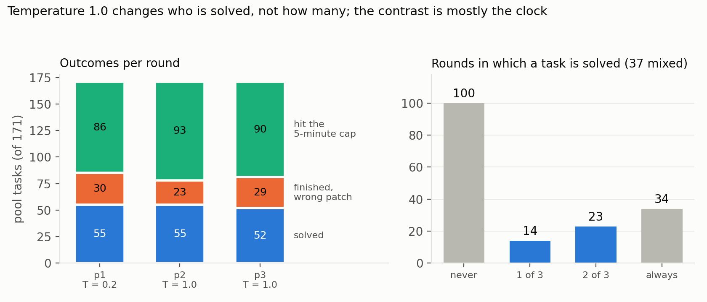
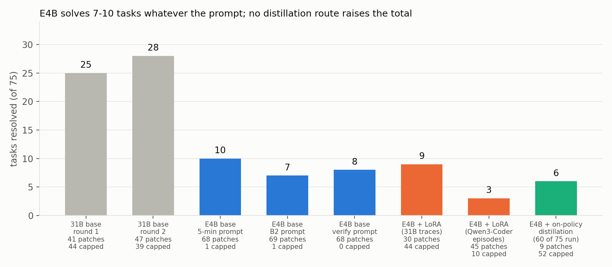

# Where the Gains Aren't: Noise, Bimodality and the Limits of LoRA Post-Training for a 4-bit Gemma 4 SWE Agent

*Subtitle: a reproducible pipeline, a harness-ready task pool, and what a 12-hour sequential budget does to evaluation*

> DRAFT 3 (2026-11-10). Open before submission: the G21 result (marked [G21]) in the abstract, Section 8 and the conclusion. Word count: `scripts/paper/count_words.py` (limit 3,000 including references).

## Abstract

We post-train and evaluate Gemma 4 as an autonomous issue-fixing agent under the Gemma 4 Developer Agent Competition's rules: a fixed 4-bit checkpoint on four L4 GPUs, a sequential scorer with a 12-hour budget, and hidden tasks from unseen repositories. (1) Evaluation is dominated by noise and task bimodality: the same agent bundle scored 0.17 and 0.13 on the public leaderboard, and of 75 local tasks attempted four times, 43 are never solved and 19 always. (2) Time binds, but not through speed: every resolved attempt finishes before the cap, a 2.1x faster 12B model solves fewer tasks, and in the scorer's sequential regime the 28-tool-call cap ends a third of attempts, yet raising it to 34 overran the 12 hours. (3) We release a pipeline for token-exact capture, memory-exact LoRA training of the 31B model on four 24 GB GPUs (sequence ceiling 10k to 18.4k tokens) and verified adapter serving; SFT on the model's own successes (28/75 and 22/75 vs base 25 and 28) and preference training on 28 own pairs (26/75) do not beat the base, and adapters cost ~10% decode speed. (4) We turn 898 SWE-rebench candidates into 171 harness-verified tasks from 142 repositories. (5) For the small E4B model (7-10/75, leaderboard 0.06) we test three distillation routes: imitating 31B successes raises precision but not the total; imitating 700 rewritten Qwen3-Coder trajectories gives 3/75 because a hindsight leak in our episode construction made 92% of its edits fail; and on-policy distillation, where the 31B scores every token of the E4B's own rollouts, [G21].

## 1. Introduction

Local coding agents are limited by two things the usual benchmark protocol hides: a hard wall-clock budget and the variance of a few dozen hidden tasks. The competition makes both explicit. Participants may change prompts, tools, sampling, per-task limits and LoRA adapters; the model is a fixed 4-bit Gemma 4 variant and the scorer runs tasks one after another within 12 hours. Public scores of prompt-only agents cluster at 0.15-0.24, and the community has reported no LoRA that beats the base model.

We ask what actually moves such an agent and what would let post-training work. Contributions: (i) a measurement protocol and noise floor for this regime; (ii) an analysis of where the clock goes, including the scorer's sequential regime; (iii) an open pipeline and pre-registered null results for LoRA post-training of the 31B model; (iv) a method and artefacts for building verified, harness-compatible tasks; (v) three distillation routes for the E4B model, including token-level on-policy distillation from the 31B. Code: https://github.com/JayGupta2003/gemma4-swe-agent-posttraining (MIT); competition data are not redistributed.

## 2. Setting

Agent: a Google ADK single agent with tools run_command, read_file, edit_file, write_file, submit_patch; model gemma-4-31b-it-qat-w4a16-ct on vLLM (tensor parallel 4, 32,768-token context, event compaction at 14,336 tokens). Scoring: the submitted patch must make hidden tests pass; one submission per day. Our baseline (B1) uses temperature 0.2, thinking budget 4,096, output cap 8,192 and a 5-minute cap; B2 uses the community recipe's 8 minutes / 28 tool calls. Local evaluation uses the scorer's harness (swegemma 0.2.11) on the 75 competition tasks whose reference patch passes in our environment, four attempts concurrently, which is ~1.5x harsher per cap-minute than the sequential scorer (24 vs 37 tokens/s per request). Every evaluation had a decision rule written down before its result; the commit history records the dates.

## 3. Noise and bimodality

*Leaderboard.* Our submissions scored 0.12 (baseline), 0.13 and 0.15 (B1), 0.17 and 0.13 (B2, byte-identical files) on 58 public tasks (one task = 0.017). Community reports give 7-13 of 58 for identical files, and one team found that configurations tied at 28/74 locally scored 0.17 and 0.10 hidden. Differences of 0.02-0.04 are indistinguishable.

*Local.* Two rounds of the same agent solve 25 and 28 of 75 tasks; 7 of the 30 tasks ever solved flip between rounds. With four attempts, 43 tasks are never solved, 19 always, 13 mixed (17%). Outcomes are set mostly by the task, which caps what learning from the model's own samples can achieve: tasks with solve probability 0 or 1 carry no contrast. *Temperature 1.0* (top_p 0.95, top_k 64) resolves 29/75 (base 25 and 28) and raises round-to-round disagreement by ~50% (9-13 vs 5-8 tasks) without raising the count. On the 171-task pool, rounds at 0.2, 1.0 and 1.0 resolve 55, 55 and 52; 100 tasks are never solved and 34 always, and 24 of the 26 tasks that differ between the first two rounds are *solved vs ran out of clock*, not *solved vs wrong patch*.

*Figure 1. Number of attempts (of four) that resolved each of 75 competition tasks. Blue: the 62 tasks whose outcome never changed.*

| submission | per-task limits | public score |
|---|---|---|
| baseline | 5 min | 0.12 |
| B1 | 5 min | 0.13, 0.15 |
| B1 + G3 adapter | 5 min | 0.08 |
| B2 | 8 min / 28 tool calls | 0.17, 0.13 (identical files) |
| B3 (B2 + thinking 2,048) | 8 min / 28 tool calls | 0.15 |
| B4 (B3 + 34 tool calls) | 8 min / 34 tool calls | exceeded 12 h, no score |
| E4B base, B2 prompt | 8 min / 28 tool calls | 0.06 |

*Table 1. Our public leaderboard scores (58 tasks; one task = 0.017).*

*Figure 5. The 171-task pool in three rounds of the 31B (temperature 0.2, 1.0, 1.0; 5-minute cap). Left: outcomes. Right: in how many rounds each task is solved.*

## 4. Where the clock goes

In 171 pool attempts (5-minute cap), all 55 resolved attempts finished before the cap and all 86 capped attempts failed, including 51 that had written a patch. Capped attempts make fewer calls than successes (median 11 vs 14) but each is slower (18 s vs 12 s of model time), 34 of 86 never edited anything, and tool execution is negligible (2-8 s per attempt). Across 3,023 requests, time = 0.74 s + 0.042 s per completion token (R² 0.988): decoding is 98% of model time, prefill ~0 (prefix caching), and reasoning is 74% of generated text.

*Faster is not better.* The 12B variant decodes 2.1x faster but writes 1.6-1.8x more per call, is capped more often (57/75 vs 44 and 39) and resolves 17/75 vs 25 and 28. Thinking budgets of 2,048 and 1,024 make 31B requests ~20% faster without losing accuracy (12 and 11 of 32 vs 10 and 11) but do not change the capped share.

*The scorer's regime.* Run sequentially like the scorer (B2, 24 tasks), the 31B resolves 9/24, in line with local rounds, but the binding limit changes: the 28-tool-call cap ends 9 of 24 attempts, more than the clock (5), 6 of them with an empty patch and 4 with 2.8-5.3 minutes left. Raising the cap to 34 (B4) exceeded the 12-hour total on the hidden set: the per-task call cap is also what keeps the whole run inside the budget, and local timing does not predict the hidden run's length.

*Figure 2. 171 pool attempts by outcome: median model calls per attempt (left) and mean model seconds per call (right).*

## 5. A pipeline for post-training the 31B model on four 24 GB GPUs

*Training model.* The scored checkpoint is 4-bit and cannot take LoRA; we train on its bf16 QAT-unquantized sibling with LoRA (r=16, alpha=32, attention+MLP, 122M parameters), staging the 62.5 GB checkpoint from network storage to local disk (200 s). Stock layers fit ~10k tokens; exact sequence-chunked decoder layers with per-chunk checkpointing (verified equal to stock at the real dimensions) and a chunked lm-head loss raise the ceiling to 18,432 tokens at 81 tokens/s. A genuine OOM leaves tensors allocated under non-reentrant checkpointing, so we train first and probe limits afterwards.

*Token-exact capture.* A logging reverse proxy between the harness and vLLM records every request with exact prompt and completion token ids (identical to /tokenize). Each prompt extends the previous one token-exactly; re-rendered assistant turns differ from the generated tokens by at most one token in 99% of pairs. Training sequences are the final prompt plus completion, with loss on every assistant span.

*Serving.* Adapters are exported in the scorer's format and verified to be applied (a canary changes outputs; every smoke round requires >=95% of agent requests to use the adapter). With an adapter vLLM decodes 33.5 vs 37.5 tokens/s and the KV cache holds 21% fewer tokens.

## 6. LoRA post-training of the 31B does not help

*G3:* 70 sequences (0.83M tokens) from the 30 tasks the base solved, one epoch: 28/75, same as the base; leaderboard 0.08. *G11:* 71 sequences from 54 tasks in 54 other repositories, two epochs, evaluated on the 75 competition tasks, all unseen: 22/75 (base 25 and 28), more capped attempts (50 vs 44 and 39), no task the base never solved; training loss fell 0.076 to 0.038, i.e. the model memorised its own successes. Other teams report the same with 314-2,000 teacher trajectories. *Preference pairs (RPO):* from the three pool rounds, chosen = fastest solved attempt and rejected = slowest unsolved one give 34 pairs, 30 of them against a capped attempt, so the signal mostly teaches finishing sooner. One epoch on the 28 cheapest pairs gives 26/75, 48 patches (base 41, 47), 45 capped (44, 39) and an unchanged median of 16 calls: a null. The implicit reward margin was positive on 19 of 28 steps, but the chosen sequences' log-probability fell by up to 226 nats (DPO's likelihood displacement).

*Figure 3. Tasks resolved of 75 (same harness, prompt and 5-minute cap) and number of capped attempts. Gray: base; blue: LoRA adapters.*

## 7. Building verified, harness-compatible tasks

From SWE-rebench [6] (6,542 filtered tasks) we selected 898 candidates (difficulty <= 2, <= 5 modified files, <= 4 per repository, no competition repositories). A CPU notebook validated each in a clean Python 3.12 environment (target tests fail with the test patch, pass with the gold patch): 318 valid + 43 nearly valid. The harness's own verification is stricter (all tests in touched files must pass; a skipped required test fails): 176 of 359 gold patches pass and 5 also pass with an empty patch (dropped), leaving **171 tasks from 142 repositories**; the unchanged 31B resolves 55. Pilots showed how the sandbox decides solvability: the subprocess sandbox never injects wheels, entries added through .pth files silently override system packages, and pytest auto-loads every package's pytest11 entry point, so one unrelated plugin crashed all 12 pilot tasks until the entry points were stripped.

*Figure 4. From 898 SWE-rebench candidates to the 171-task pool.*

## 8. The small model: three routes to distil into E4B

The competition rewards the best private score with the 8B-parameter E4B. Under the B2 budget the unmodified E4B resolves **10, 7 and 8 of 75** under three prompts, every solved task being one the 31B also solves; it is fast (114-125 s per task, at most one capped attempt) and scores 0.06 on the leaderboard. Its tokenizer and chat template reproduce real 31B prompts token for token (60/60 captured requests), so sequences and token-level scores transfer between the two models.

*Imitating 31B successes.* LoRA (34.9M parameters) on the 71 31B-resolved pool sequences: 9/75. Among finished attempts precision rises (29% vs 17%), but the adapter explores until the call budget is spent, then repeats `submit_patch` with an empty patch hundreds of times (the harness does not end the session), so only 30 attempts write a patch (base 68).

*Imitating a stronger teacher.* We rewrote resolved Qwen3-Coder-480B OpenHands trajectories (nebius/SWE-rebench-openhands-trajectories, CC BY 4.0; 63k tokens median, too long to imitate whole) into short episodes in our tool schema: search, read, one edit per hunk of the final patch, test, submit; 700 episodes from 597 repositories, rendered exactly as vLLM does. The adapter resolves **3/75**. The capture shows why: 522 of 568 edit calls fail because the old text is not in the file. Our converter chose each read window around the final hunk, i.e. from the answer; the student learned "read once, then edit" but at test time cannot know where to read, and writes edits for code it never saw. Hindsight pruning must only keep steps the student could have taken without the answer.

*On-policy distillation.* Following GKD [11] and MiniLLM [12], the student generates and the teacher grades: the unmodified E4B ran the 171 pool tasks (25 resolved; 244 context segments, 2.93M tokens), then the 31B scored every token of those contexts in one prefill each through vLLM's prompt log-probabilities (top 8; this needs chunk length x vocabulary x 4 bytes of free GPU memory, so 2,048-token chunks failed and 512 worked, 48 minutes). On the student's own tokens the 31B's top choice agrees 82% of the time and gives under 10% probability to 10%, a dense signal that needs no task success. The loss is the exact KL divergence between student and teacher coarse-grained to the teacher's top 8 tokens plus one "rest of vocabulary" bucket (known, because the top-8 log-probabilities are over the full vocabulary), reverse direction, on 712k student tokens. Rule written before the run: >= 15/75 with >= 55 patches is a candidate, 12-14 a weak signal, <= 11 null. [G21]

*Figure 6. Tasks resolved of 75 by the 31B and the E4B, with patches written and capped attempts under each bar.*

## 9. Related work

SWE-bench [1] and SWE-agent [2] define the task and interface. Training on verified trajectories is studied in SWE-Gym [3], SWE-smith [4] and R2E-Gym [5], mostly with full fine-tuning of 7-32B models and thousands of trajectories; SWE-rebench [6] is our task source. Preference optimisation with a likelihood term [7] and trial-and-error pairs [8] motivate our preference design; on-policy distillation [11, 12] our E4B method. LoRA [9] and DPO [10] are the underlying methods.

## 10. Limitations

One model family; three repositories dominate the 75 local tasks; single rounds with a paired noise of +-3 tasks; no hidden-set evidence of any adapter gain; E4B rounds of 7-10 tasks that a few flips can reorder; leaderboard numbers and community results are single runs or unverified forum reports; most local timing is concurrent while the scorer is sequential.

## 11. Conclusion and release

Under a sequential 12-hour budget, noise and task bimodality set the ceiling of evaluation, the per-task budgets bind the whole run, and LoRA imitation of typical successes adds nothing while costing speed. For the small model, sequence imitation either shifts behaviour without adding skill or, if episodes leak the answer, teaches unrealisable shortcuts; [G21]. What transfers is the machinery: exact capture, memory-exact training, adapter verification, a verified-task pipeline, teacher scoring at token level and the protocol to read results honestly. Code, scripts, task IDs (not task text) and notebooks: https://github.com/JayGupta2003/gemma4-swe-agent-posttraining (MIT).

## References
[1] Jimenez et al. SWE-bench: Can Language Models Resolve Real-World GitHub Issues? ICLR 2024. arXiv:2310.06770.
[2] Yang et al. SWE-agent: Agent-Computer Interfaces Enable Automated Software Engineering. NeurIPS 2024. arXiv:2405.15793.
[3] Pan et al. Training Software Engineering Agents and Verifiers with SWE-Gym. ICML 2025. arXiv:2412.21139.
[4] Yang et al. SWE-smith: Scaling Data for Software Engineering Agents. arXiv:2504.21798.
[5] Jain et al. R2E-Gym: Procedural Environments and Hybrid Verifiers for Scaling Open-Weights SWE Agents. arXiv:2504.07164.
[6] Badertdinov et al. SWE-rebench: An Automated Pipeline for Task Collection and Decontaminated Evaluation of Software Engineering Agents. NeurIPS 2025 D&B. arXiv:2505.20411.
[7] Pang et al. Iterative Reasoning Preference Optimization. NeurIPS 2024. arXiv:2404.19733.
[8] Song et al. Trial and Error: Exploration-Based Trajectory Optimization for LLM Agents. ACL 2024. arXiv:2403.02502.
[9] Hu et al. LoRA: Low-Rank Adaptation of Large Language Models. ICLR 2022. arXiv:2106.09685.
[10] Rafailov et al. Direct Preference Optimization. arXiv:2305.18290.
[11] Agarwal et al. On-Policy Distillation of Language Models: Learning from Self-Generated Mistakes. ICLR 2024. arXiv:2306.13649.
[12] Gu et al. MiniLLM: On-Policy Distillation of Large Language Models. arXiv:2306.08543.
