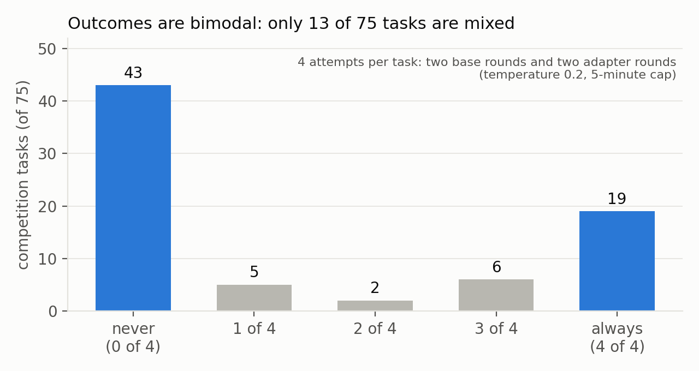
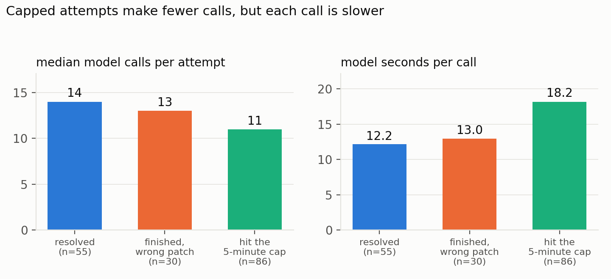
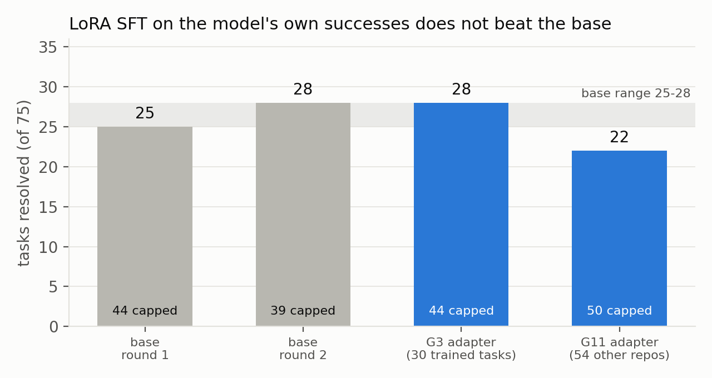
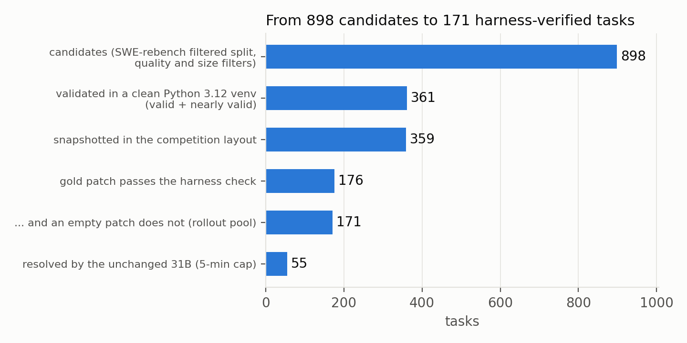

# Where the Gains Aren't: Noise, Bimodality and the Limits of LoRA Post-Training for a 4-bit Gemma 4 SWE Agent

*Subtitle: a reproducible pipeline, a harness-ready task pool, and what a 12-hour sequential budget does to evaluation*

> DRAFT 1 (2026-10-24). Items in [BRACKETS] are pending experiments (E4B distillation, temperature probe, preference gate, leaderboard repeats) and must be filled or deleted before submission. Word count is checked by `scripts/paper/count_words.py` (limit 3,000 including references).

## Abstract

We post-train and evaluate Gemma 4 as an autonomous issue-fixing agent under the Gemma 4 Developer Agent Competition's rules: a fixed 4-bit checkpoint served on four L4 GPUs, a sequential scorer, a 12-hour total budget, and hidden tasks from unseen repositories. We report four findings. (1) Evaluation is dominated by noise and by the bimodality of tasks: identical agent files score 0.12-0.22 on the public leaderboard, and on 75 tasks with four attempts each, 43 are never solved, 19 always, and only 13 are mixed. (2) Time is the binding resource, but speed is not what separates success from failure: every resolved attempt finished before the cap, capped attempts make fewer, slower calls, and a model that decodes 2.1x faster (12B) still solves fewer tasks because it writes more per call. (3) We build and release a pipeline for token-exact trajectory capture, memory-exact LoRA training of the 31B model on four 24 GB GPUs (sequence ceiling 10k -> 18.4k tokens), scorer-format adapter export and verification; with it, two LoRA SFT runs on the model's own verified successes, including one trained on 54 repositories and tested on 75 unseen-repository tasks, do not improve over the base (28/75 and 22/75 vs 25 and 28), and the adapter costs ~10% decode speed. (4) We turn 898 SWE-rebench candidates into a harness-ready pool of 171 verified tasks from 142 repositories and document the sandbox conventions that silently decide whether a task is solvable. [E4B: ...]

## 1. Introduction

Local coding agents are limited by two things the usual benchmark protocol hides: a hard wall-clock budget and the variance of a few dozen hidden tasks. The competition makes both explicit. Participants may change a prompt, tools, sampling, per-task limits and LoRA adapters; the model is fixed to a 4-bit Gemma 4 variant and the scorer runs tasks one after another within 12 hours. Public leaderboard scores of prompt-only agents cluster at 0.15-0.24 and the community has reported no LoRA that beats the base model.

We ask what actually moves such an agent, and what would let post-training work. Contributions: (i) a measurement protocol and noise floor for this regime; (ii) an analysis of where the clock goes; (iii) an open pipeline and honest null results for LoRA post-training of the 31B model; (iv) a method and artefacts for building verified, harness-compatible tasks; [(v) E4B result]. All code is Apache-2.0 (repository link at submission); competition data are not redistributed.

## 2. Setting

Agent: Google ADK single agent with tools run_command, read_file, edit_file, write_file, submit_patch (code-graph tools exist but are rarely used); model gemma-4-31b-it-qat-w4a16-ct on vLLM, tensor parallel 4, 32,768-token context, ADK event compaction at 14,336 tokens. Scoring: the submitted patch must make the hidden tests pass; one score per submission, one submission per day. Our baseline (B1) uses temperature 0.2, thinking budget 4,096, output cap 8,192 and a 5-minute cap; B2 uses the community recipe's 8 minutes / 28 tool calls. Local evaluation uses the same harness version (swegemma 0.2.11, adk_submission 0.2.13) on the 75 competition tasks whose reference patch passes in our environment, four attempts concurrently; this is ~1.5x harsher per cap-minute than the sequential scorer (24 vs 37 tokens/s per request).

## 3. Noise and bimodality

*Leaderboard.* Our submissions scored 0.12 (baseline), 0.13 and 0.15 (B1), 0.17 (B2) on 58 public tasks (one task = 0.017). Community reports (forum threads 751596, 750974, 751973) give 7-13 of 58 for identical files, and one team found that two configurations tied at 28/74 locally scored 0.17 and 0.10 hidden, and that a change that won 9-0 locally scored lower. Differences of 0.02-0.04 between configurations are therefore indistinguishable.

*Local.* Two rounds of the same agent solve 25 and 28 of 75 tasks; 7 of the 30 tasks ever solved flip between rounds. With four attempts (two base rounds and two adapters), 43 tasks are never solved, 19 always solved, 13 mixed (17%). Outcomes are set mostly by the task, not by sampling, which caps what any learning from the model's own samples can achieve: tasks with solve probability 0 or 1 carry no contrast. We computed that 3 additional rounds over the 171-task pool would yield only ~20 matched success/failure pairs at temperature 0.2. [TEMPERATURE PROBE: temperature 1.0 changes the mixed fraction from 17% to X%.]

*Figure 1. Number of attempts (of four) that resolved each of 75 competition tasks. Blue: the 62 tasks whose outcome never changed.*

| submission | per-task limits | public score |
|---|---|---|
| baseline | 5 min | 0.12 |
| B1 | 5 min | 0.13, 0.15 |
| B1 + G3 adapter | 5 min | 0.08 |
| B2 | 8 min / 28 tool calls | 0.17 |

*Table 1. Our public leaderboard scores (58 tasks; one task = 0.017).*

## 4. Where the clock goes

In 171 pool attempts (5-minute cap), all 55 resolved attempts finished before the cap and all 86 capped attempts failed, including 51 that had written a patch (the harness verifies it; none passed). Capped attempts make fewer calls than successes (median 11 vs 14) but each is slower (18 s vs 12 s of model time per call), 34 of 86 never edited anything, and tool execution is negligible (2-8 s per attempt); the long gaps are context-compaction summaries. Model time per call is almost entirely decoding.

Two controlled checks. *Smaller model:* the 12B variant decodes 2.1x faster (79.2 vs 37.5 tokens/s single stream) but writes 1.6-1.8x more per call, runs out of time more often (57/75 capped vs 44 and 39) and resolves 17/75 vs 25 and 28; it never solved a task the 31B missed. Capping its thinking at 2,048 tokens left the outcome unchanged (6/32 vs 6/32). *Shorter thinking for the 31B:* budgets of 2,048 and 1,024 cut the share of model time in turns over 2,000 tokens from 23% to 12% and 1.3%, made requests ~20% faster, and kept accuracy (12 and 11 of 32 vs 10 and 11) but did not change the capped share. Speed alone does not convert the bimodal middle into solutions; the remaining failures are mostly wrong fixes in the right place (community failure anatomy: 18 of 41 failed runs edited within 20 lines of the gold change) and never committing to an edit.

*Figure 2. 171 pool attempts by outcome: median model calls per attempt (left) and mean model seconds per call (right).*

| | 31B | 12B |
|---|---|---|
| decode speed (tokens/s) | 37.5 | 79.2 |
| completion tokens per call | 1x | 1.6-1.8x |
| capped attempts (of 75) | 44 / 39 | 57 |
| resolved (of 75) | 25 / 28 | 17 |

*Table 2. 31B vs 12B on the 75 competition tasks.*

## 5. A pipeline for post-training the 31B model on four 24 GB GPUs

*Training model.* The scored checkpoint is compressed 4-bit and cannot take LoRA; we train on its bf16 QAT-unquantized sibling with LoRA (r=16, alpha=32, attention+MLP, 122M parameters), staging the 62.5 GB checkpoint from network storage to local disk (200 s) and spreading it over four GPUs. Stock layers fit ~10k tokens; exact sequence-chunked decoder layers with per-chunk checkpointing (verified equal to stock at the real dimensions) and a chunked lm-head loss raise the ceiling to 18,432 tokens at 81 tokens/s, peak 21 GiB per GPU. A post-OOM leak (non-reentrant checkpointing keeps tensors after a genuine OOM) was found and avoided by training first, probing limits afterwards.

*Token-exact capture.* A logging reverse proxy between the harness and vLLM records every request and response with the exact prompt and completion token ids (3,061 requests in one round, ids identical to /tokenize). Each prompt extends the previous one token-exactly; the history re-rendering of an assistant turn differs from the generated tokens by at most one token in 99% of pairs. Training sequences are the final prompt plus final completion with loss on every assistant span.

*Serving.* Adapters are exported in the scorer's format and verified to be applied (a canary adapter changes outputs; every smoke round gates on >=95% of agent requests using the adapter's model name). With an adapter vLLM decodes 33.5 vs 37.5 tokens/s and the KV cache holds 21% fewer tokens; other teams measure 15-20% per call.

## 6. LoRA SFT on the model's own successes does not help

*G3:* 70 sequences (0.83M tokens) from the 30 tasks the base solved, one epoch, evaluated on all 75 tasks (the trained tasks are exactly the base's solved set): 28/75, same as the base, 2 of 45 never-solved tasks solved (consistent with chance: 7 tasks flip between base rounds); leaderboard 0.08. *G11:* 71 sequences (0.87M tokens) from 54 tasks in 54 different repositories, two epochs, evaluated on the 75 competition tasks, all unseen: 22/75 (base 25 and 28), more capped attempts (50 vs 44 and 39), no task solved that the base never solved; training loss fell 0.076 -> 0.038, i.e. the model memorised its own successes. Other teams report the same with 314-2,000 teacher trajectories (Qwen3-Coder, DeepSeek) on the 31B. We pre-registered the decision rule (>=34/75 or fewer capped without losses) before each evaluation. [PREFERENCE: gate result and, if run, RPO result.]

*Figure 3. Tasks resolved of 75 (same harness, prompt and 5-minute cap) and number of capped attempts. Gray: base; blue: LoRA adapters.*

## 7. Building verified, harness-compatible tasks

From the SWE-rebench filtered split (6,542 tasks) we selected 898 candidates (difficulty <= 2, <= 5 modified files, <= 10 target tests, <= 4 per repository, no competition repositories). A CPU notebook with internet validated each in a clean Python 3.12 environment (target tests fail with the test patch, pass with the gold patch): 318 valid + 43 nearly valid (40%), at ~216 tasks per hour. We then rebuilt snapshots in the competition's layout and a shared wheel set and ran the harness's own verification, which is stricter (all tests in the touched files must pass; a skipped required test fails): 176 of 359 gold patches pass and 5 also pass with an empty patch (dropped), leaving **171 tasks from 142 repositories**; the unchanged 31B resolves 55 (32%). Four pilots taught how the sandbox decides solvability: the subprocess sandbox never injects wheels, so dependencies come from the host; entries added through the environment's .pth files precede the system packages and silently override them; pytest auto-loads every package's pytest11 entry point, so a plugin from an unrelated dependency crashed all 12 pilot tasks until the entry points were stripped; and ~24% of real fixes are unpassable under the harness conventions (community audit).

*Figure 4. From 898 SWE-rebench candidates to the 171-task pool.*

## 8. [Small model] E4B distillation

[PENDING: base E4B on 75 tasks; LoRA on the 31B's verified sequences (same tokenizer and chat template, so token-exact sequences transfer); results on held-out tasks; leaderboard.]

## 9. Related work

SWE-bench [1] and SWE-agent [2] define the task and the agent-computer interface. Training on verified trajectories is studied in SWE-Gym [3], SWE-smith [4] and R2E-Gym [5], mostly with full fine-tuning of 7-32B models; SWE-rebench [6] provides the task source we use. Preference optimisation with a likelihood term on the winner [7] and trial-and-error trajectory pairs [8] motivate our preference design, which our bimodality analysis shows is data-limited here. LoRA [9] and DPO [10] are the underlying methods.

## 10. Limitations

One model family, three repositories dominate the 75 local tasks, single rounds with a paired noise of +-3 tasks, no hidden-set evidence of any adapter gain, leaderboard numbers and community results are single runs and forum reports we did not verify, and local timing is concurrent (24 tokens/s) while the scorer is sequential (37).

## 11. Conclusion and release

Under a sequential 12-hour budget, noise and task bimodality set the ceiling of evaluation, finishing time is not the lever once the model is not slower than its tokens, and LoRA SFT on typical self-generated successes adds nothing while costing speed. What transfers is the machinery: exact capture, memory-exact training, adapter verification, a verified-task pipeline and the protocol to read results honestly. Code, scripts, task IDs (not task text) and the analysis notebooks are released under Apache-2.0.

## References
[1] Jimenez et al. SWE-bench: Can Language Models Resolve Real-World GitHub Issues? ICLR 2024. arXiv:2310.06770.
[2] Yang et al. SWE-agent: Agent-Computer Interfaces Enable Automated Software Engineering. NeurIPS 2024. arXiv:2405.15793.
[3] Pan et al. Training Software Engineering Agents and Verifiers with SWE-Gym. ICML 2025. arXiv:2412.21139.
[4] Yang et al. SWE-smith: Scaling Data for Software Engineering Agents. arXiv:2504.21798.
[5] Jain et al. R2E-Gym: Procedural Environments and Hybrid Verifiers for Scaling Open-Weights SWE Agents. arXiv:2504.07164.
[6] Badertdinov et al. SWE-rebench: An Automated Pipeline for Task Collection and Decontaminated Evaluation of Software Engineering Agents. NeurIPS 2025 D&B. arXiv:2505.20411.
[7] Pang et al. Iterative Reasoning Preference Optimization. NeurIPS 2024. arXiv:2404.19733.
[8] Song et al. Trial and Error: Exploration-Based Trajectory Optimization for LLM Agents. ACL 2024. arXiv:2403.02502.
[9] Hu et al. LoRA: Low-Rank Adaptation of Large Language Models. ICLR 2022. arXiv:2106.09685.
[10] Rafailov et al. Direct Preference Optimization. arXiv:2305.18290.
